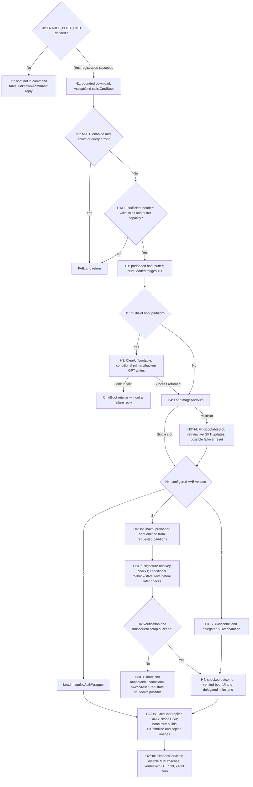

# M10 temporary execution: source paths, RB1 machine code and Sony limits

2026-10-15. Offline analysis only. No device, ADB-server or bootloader request;
no firmware execution. N1/N2 implementations and original evidence are unchanged.

**Result:** the historical source can change persistent boot state before overall
authentication succeeds. In the acquired RB1 binary, the normal locked-device
rejection precedes header parsing, slot clearing and authentication. Neither
behavior has been established for Sony's `boot` command. Its registration and
acceptance policy remain the decisive missing evidence.

## Historical source: configuration and control flow

All historical locators below refer to Code Aurora commit
`7cbbe2bcdf354c1a65712b040b2c0763f26f08f1`, not Sony or an RB1 source/build match.
Selected new members were acquired by bounded HTTP reads at that immutable commit.

In the supplied [DSC build options, lines 97–108][H0], the GCC build defines
`ENABLE_BOOT_CMD` when **`USER_BUILD_VARIANT == 0`**, alongside partition-update
and critical-unlock commands. The other branch defines `USER_BUILD_VARIANT`.
The [command table, lines 2400–2440][H1] includes `boot` only under its own macro.
Consequently, temporary boot is present in the standard non-user configuration;
the standard user branch does not enable it. External build overrides remain
possible. Android's running build variant does not identify the ABL build flags.

`AcceptCmd` matches a registered prefix and passes the USB download buffer and
received byte count to its handler. `CmdDownload` bounds the requested size;
`AcceptData` accumulates received bytes and returns to command state on completion.
Registration alone grants no authentication authority. The historical `CmdBoot`
contains no direct unlock-state test; its configuration and downstream checks
still matter. [H1][H1]

The following diagram describes the pinned source's call paths. H0–H8 are exact
source links in the locator table beneath it. Conditional state writes are
marked explicitly; no node asserts execution on Sony.

The `FindBootableSlot` node applies only to multislot operation; otherwise the
wrapper selects `boot` or recovery directly. Errors in delegated AVB1 calls,
allocation or slot selection have their own early returns. The graph highlights
the acceptance/state sequence rather than treating every error as one FAIL.

| Locator | Relevant implementation |
| --- | --- |
| [H0][H0] | `QcomModulePkg.dsc:97–108`: build flags |
| [H1][H1] | `FastbootCmds.c:1019–1057,1601–1659,1879–1962,2209–2315,2400–2440`: download, dispatch, handler, registration |
| [H2][H2] | `BootLinux.c:507–600`: legacy header sizing; `71–490`: image/DT setup and handoff; `708–724`: build/dev-image flags |
| [H3][H3] | `PartitionTableUpdate.c:174–334,342–355,997–1028,1135–1285,1349–1414`: GPT update, active flags, rollback-write eligibility, failover and retry handling |
| [H4][H4] | `VerifiedBoot.c:72–84,114–196,198–260,284–499,503–664`: AVB selection, preloaded-image handling, errors and delegated calls |
| [H5][H5] | `avb_slot_verify.c:100–149,430–580,613–700`: requested-partition filtering, trusted metadata and rollback ordering |
| [H6][H6] | `avb_ops.c:308–403`: OEM/user-key trust and rollback callbacks |
| [H7][H7] | `DeviceInfo.c:268–296`, `LinuxLoaderLib.c:491–514`: device-state write and delegated storage backend |
| [H8][H8] | `ShutdownServices.c:29–105`: ExitBootServices loop and CPU preparation |

### Persistent effects and rejection behavior

| Path / necessary conditions | Reachable effect and ordering |
| --- | --- |
| Valid-sized temporary image, multislot layout and resolvable active boot entry | `ClearUnbootable` clears the active entry's unbootable bit before `LoadImageAndAuth`. The update routine writes primary and backup GPT blocks if its cached/on-media attributes differ. Consistent attributes skip writing. No authentication success is required. |
| Multislot selection; unsuccessful but bootable active slot with retries remaining; dev-image flag false | `FindBootableSlot` decrements retry count and updates GPT before cryptographic verification. `MarkPtnActive` also updates active flags across matching slot partitions; unchanged state can avoid physical writes. The dev-image flag is set later in `BootLinux` when a `root=` command line is seen; a fresh zero-initialized flag does not protect this earlier path. |
| AVB2 metadata passes applicable signature/key checks; metadata index exceeds stored index; current slot has successful and not-unbootable flags | The libavb implementation calls `write_rollback_index` **before subsequent descriptor/partition checks finish**. Its callback writes the `DeviceInfo` record through `VBRwDeviceState(WRITE_CONFIG)`. This is a delegated persistent-write request, not proof of RPMB/fuse layout or a successful hardware write. Later verification can still fail. |
| AVB2 failure after initialization | Cleanup calls `HandleActiveSlotUnbootable`. Except for its first-boot/non-user exception, it sets the unbootable bit and updates GPT. A successful, bootable alternate slot can be activated and cold-reset. The literal OR/mask expression does not independently clear the current successful bit; do not substitute its comment for its behavior. |
| Failed authentication with red state | The wrapper can display red-state UI, wait and request shutdown. MDTP-related handling and milestone calls are delegated. A rejected image is not guaranteed to leave an idle reusable fastboot endpoint. |

`UpdatePartitionAttributes` returns **void**: its read/write errors are not
propagated as a transaction result through `ClearUnbootable`. Primary/backup
writes can be partial. `ClearUnbootable` lookup failures cause `CmdBoot` to
return without sending a FAIL, which can leave the host waiting. These findings
invalidate a general assumption that rejected temporary boots leave state intact.
No such write has been observed on the Sony.

The download byte count/buffer are not cleared by this handler's ordinary early
FAIL returns. A later command cannot be assumed to operate on an empty buffer.
The delegated device-state backend is [independently located here][H9].

### Authentication coverage and handoff limits

AVB1 passes the calculated boot-image buffer/length to the verified-boot protocol;
the implementation behind that protocol is outside these inspected members.
The legacy length calculation includes page-rounded kernel, ramdisk and DT-size
regions; it reads `second_size` without adding it to that length. Header parsing
does not itself authenticate any region.

In this AVB2 implementation, an already-loaded image makes the requested list
start after `boot`, leaving `dtbo`. The libavb hash handler explicitly skips
unrequested partitions. Thus this selected path does **not establish a hash check
of the downloaded boot buffer**. Trusted vbmeta/key/rollback and DTBO checks still
run. This is a configuration-specific historical coverage finding, not a Sony
bypass, nor proof that arbitrary images boot on any physical platform.

The loader subsequently changes command-line/DT data, appends platform/verified-
boot information, copies images and prepares CPU state. The source hands the
AArch64 kernel a DT address in x0 and zero in x1–x3. USB stops before handoff;
successful kernel startup is not guaranteed to retain fastboot communication.
The inspected shutdown helper supplies no board watchdog/charging recovery
contract. Its state is distinct from authenticating the original input bytes.

## RB1: machine-code evidence, not a string inference

Inputs remain private and unchanged:

| Artifact | SHA-256 |
| --- | --- |
| Acquired `abl.elf`, 151,552 bytes | `79171d47c60bae5b99f56752a95367b3fe5118945589882650c62b83e34edb74` |
| Extracted `LinuxLoader` PE, 385,024 bytes | `f37bfb0d6c3fb2cb90469ffca819261fd1a1ab326628f4754eed42171c8411ed` |

The outer ELF32/ARM wrapper is not the instruction architecture. The extracted
PE32+ machine is **0xaa64/AArch64**, preferred image base zero, entry RVA `0x1000`.
Its `.text`, `.data`, `.reloc` section mappings were parsed separately. For this
particular PE, raw offset equals RVA in the relevant sections; that coincidence
must not be generalized. An actual load base is added to these RVAs at runtime.
The compressed ELF/FV location is not an executable address.

The following is **verified static evidence from the acquired RB1 artifact**,
not observed execution on RB1 hardware. Function names are semantic assignments
to stripped code; instruction bytes/RVAs are the authoritative locators.

| Evidence | Established behavior |
| --- | --- |
| Constant entry at RVA `0x3f398`: name pointer `0x3f00c` (`boot`), handler `0x26600` | Temporary boot is compiled into the command-description table. |
| Setup loop `0x243d4–0x243f8`; node construction `0x245b4–0x24614`; dispatcher `0x23538–0x23560` | Setup consumes 19 entries, including boot, and links each successfully allocated handler node. Dispatch loads the handler at node+0x18 and calls it. Registration depends on setup/allocation succeeding; this is stronger than finding an unused string/table alone. |
| Helper `0x1c0e8`; byte load at `0x1c104` from state structure+0x0d | Reads a cached state byte without calling a storage service. Its use at `0x26d60–0x26d78` selects true/false for `Device unlocked: %a`, independently tying it to unlock state. Historical 13-byte device-info magic is supporting structural similarity. |
| `0x26624`: call helper; `0x26628`: test low byte; `0x2662c`: `b.eq 0x26644` | Zero/unlocked-false enters the locked rejection before the image-size test at `0x26630` or header call at `0x26670`. Branch immediates were independently decoded from instruction words. |
| `0x26644/0x26648`: ADRP/ADD to diagnostic `0x3eb28`; `0x2664c`: call FAIL wrapper; `0x26650`: branch to epilogue | This is a reachable normal locked-state rejection path in the registered handler. It blocks even a correctly signed image at this gate; it does not inspect that image first. |
| Unlocked/valid-header path: `0x26708` calls `0x1adc0`; `0x26744` calls `0x5554` | Slot clearing precedes the load/auth wrapper on this different branch. |
| Clear helper `0x1ae28–0x1ae44`; GPT callback `0x18258/0x18280` | Clears attribute bit 55, then calls the GPT-update candidate at `0x17a90`. That function has distinct block read and write callback sites, with the write slot at protocol+0x20. The complete selected routine and its conditional update code are preserved privately. This supports a pre-authentication storage-write path after the locked gate has passed. |
| Success path `0x2675c–0x26770`; kernel-call site `0xbccc–0xbce0` | Calls menu cleanup, sends success, stops the USB path, then calls the kernel-handoff candidate at `0xa518`. The latter indirect call zeros x1–x3; x0 and the target come from prepared locals. This is not a measured boot or a complete proof of all target/DT preparation. |

The normal locked-handler path contains **24 instructions**, treating inspected
helpers as returning and assuming healthy stack canaries. Its initial helpers
set up stack protection, zero a stack-local structure and read cached unlock
state. It does not reach image mutation, header parsing, `ClearUnbootable`, the
load/auth wrapper or kernel handoff. FAIL formatting modifies RAM and delegates
USB transmission/logging. Those external callbacks and abnormal canary-failure
behavior are not exhaustively audited; no global promise of zero persistent
effects follows. No hardware writes occurred during this static analysis.
The read/write callback offsets were checked against the independent
[TianoCore Block I/O protocol declaration][H10] with AArch64 pointer sizes.

### RB1 authentication is a different, partially delegated model

The load/auth wrapper contains an indirect certificate-verification call at
`0x5d10`, associated with the ASN1/X509 protocol GUID
`408ec123-134e-4b80-9142-b89a0e08f8b3` and the OEM-certificate diagnostic.
It also locates the verified-boot protocol GUID matching historical H7's public
header. Shared GUIDs do not prove identical implementations.

The certificate path is conditional: a state-derived boolean from `0x6f10`
and a build helper at `0xd348` determine a verification/skip branch. The latter
returns zero on its normal path; a zero state boolean reaches the debug-skip
branch. Actual RB1 security state was not measured. Complete image-signature
coverage, protocol internals and rollback persistence were not reconstructed.
No reachable Sony authentication policy is inferred from these reference calls.

## Comparison and the Sony decision

Preserved [N1](m10-n1-results.md)/[N2](m10-n2-results.md) establish Sony's
`icx1301`, `unlocked:no`, `secure:yes`, slot `b`, `is-userspace:no`, unavailable
bootloader version and intact-stock return. They contain no boot-image download
or execution transaction. None of the reference write/acceptance paths below
can yet be attributed to this Sony implementation.

| Question | Historical pinned source | Acquired RB1 machine code | Physical Sony NW-A306 |
| --- | --- | --- | --- |
| Temporary command exists? | Macro-controlled; standard DSC enables non-user build | Table, registration loop and dispatcher consume boot handler | Unknown; N1/N2 queried metadata only |
| Locked-device gate before header? | No direct gate in CmdBoot | Explicit cached-unlocked test rejects first | Unknown despite `unlocked:no`, `secure:yes` |
| Pre-auth state writes? | GPT clear/retry/active flags; conditional rollback update; failure-driven slot changes | Clear/write path after unlock gate, before auth wrapper; excluded from normal locked handler rejection | No payload tested; neither presence nor absence established |
| Complete downloaded-image authentication? | Conditional paths and delegated VB1; selected preloaded VB2 path excludes boot hash | Different conditional certificate path; coverage incomplete | Unknown |
| Return/repair? | Can reset, shut down or leave no reply | Normal locked path returns FAIL; broader failures/delegation remain | Intact-stock N1/N2 Power return and N2 identities verified; corrupted-image restoration unproved |

**RB1 is the stronger model for studying a concrete early locked-state gate.**
The historical source is the stronger readable model of state-write/failure
hazards and compile-time omission. Neither is a match to Sony's loader. The
historical owner report that Sony's unlock-ability command was unknown differs
from RB1's compiled command table and is consistent with selective command
omission; original response logs remain unavailable. It cannot prove that boot
is omitted too, and no diagnostic was repeated to test it.

Sony-specific progress in this increment is a bounded, hash-verified filename
inventory of the existing 3.06 GPL archive: **85,019 members**, no named
`FastbootCmds.c`, `FastbootMain.c`, `LinuxLoader.c`, `QcomModulePkg`, applicable
loader image or selected boot-image hit. No contents were extracted. The archive
SHA-256 remains `5bf646baad7d99a3c598cdc1050fdb1af9a944c9ee6dcbd7e60680c313cfc477`.
This does not exclude differently named embedded code. The existing encrypted
UPG, updater analysis and denied cache query supply no plaintext dispatcher.
Targeted public searches found no build-bound original Sony temporary-boot
transaction or authentic loader artifact; casual unlock/recovery assertions
were not promoted to evidence. No updater work was repeated.

### Remaining execution hypothesis and next concrete investigation

The candidate remains a Sony-supported temporary handler admitting an independent
payload under an achievable trust policy. **No viable acceptance mechanism is
established.** If Sony omits boot as the standard historical user build does,
ordinary temporary fastboot execution is unavailable through that dispatcher.
If Sony uses RB1's early locked gate, a stock signature alone cannot admit a
temporary image. An owner-authorized trust transition or another demonstrated
entry would then be needed; neither is established here.

The next precise target is a **build-bound Sony command table and the branch
between command dispatch and header parsing**, followed by its trust consumer.
The least-risk acquisition avenue is an authentic plaintext Sony loader/decoded
OTA artifact available without changing this player, or an already-existing
original, build-bound transaction capture that distinguishes command omission
from early locked rejection. A complete storage dump is not mandatory. No such
input was located in the bounded work above; this is the current evidence blocker.

A new physical test must supply genuinely new handler evidence. It cannot be
justified as another getvar cycle, an empty/header-only image or a presumed
harmless command-only boot request: Sony's buffer behavior, state writes and
failure exits are unknown. A real boot-image transaction is not approval-ready
until an applicable image and the following recovery requirements exist.
No new physical procedure is proposed for execution in this increment.

Before the first image experiment, establish:

1. Same-board accepted stock restoration beyond a normally functioning Android
   installation, including the entry mechanism and its surviving failure scope.
2. Exact original layout/boot-control data and applicable loader, boot, DT/overlay
   and AVB images; preserve unique calibration/provisioning and security-bound
   state. A generic RB1 GPT template or another board's dump is insufficient.
3. Trusted-key and rollback compatibility, including whether a trial can raise
   counters that make the original image unacceptable; raw byte restoration may
   not reverse secure-state changes.
4. The Sony handler's pre-authentication/failure writes and a recovery method
   covering GPT/slot changes and interrupted writes, not just a Power-button exit.
5. Reviewed initial Linux storage, watchdog, power/charging and shutdown behavior.
   RAM delivery does not prevent the executed kernel from changing hardware/state.

## Engineering changes and actual validation

- `tools/inspect_arm64_pe.py`: bounded extracted-PE32+/AArch64 parser, file/RVA
  mapping, static ranges and direct ADR/adjacent ADRP+ADD references. It rejects
  ELF input rather than disassembling the wrapper's ARM header as executable code.
  References are candidates, not an automatic reachability claim.
- `tests/test_inspect_arm64_pe.py`: seven synthetic tests for differing offsets,
  zero-fill tails, malformed/overlapping sections, bounds, architecture, load-base
  handling and reference decoding/clobber rejection. Optional Capstone 5 is used
  from a private pinned 5.0.6 wheel; no dependency was installed globally.
- `docs/m10-boot-execution-analysis.md`: this report and source-linked diagram.
- `docs/m10-boot-feasibility.md`: current result linked above preserved history.

**50 inspection tests passed, zero failures/errors/skips**, including all seven
new tests; N2 tests were not rerun. **22 RB1 artifact/branch/path checks** and
**12 historical source-order/configuration checks** passed. CLI reproduction,
instruction bytes, complete selected disassembly ranges, hashes, source receipts
and the exact evidence limitations remain private under ignored
`build/m10/boot-execution-20261015-01/`. These are static checks, not physical boots
or firmware-write measurements. Earlier evidence is preserved; M10 remains open.

[H0]: https://gitlab.com/Codeaurora/abl_tianocore_edk2/-/blob/7cbbe2bcdf354c1a65712b040b2c0763f26f08f1/QcomModulePkg/QcomModulePkg.dsc#L97
[H1]: https://gitlab.com/Codeaurora/abl_tianocore_edk2/-/blob/7cbbe2bcdf354c1a65712b040b2c0763f26f08f1/QcomModulePkg/Library/FastbootLib/FastbootCmds.c#L1879
[H2]: https://gitlab.com/Codeaurora/abl_tianocore_edk2/-/blob/7cbbe2bcdf354c1a65712b040b2c0763f26f08f1/QcomModulePkg/Library/BootLib/BootLinux.c#L507
[H3]: https://gitlab.com/Codeaurora/abl_tianocore_edk2/-/blob/7cbbe2bcdf354c1a65712b040b2c0763f26f08f1/QcomModulePkg/Library/BootLib/PartitionTableUpdate.c#L1267
[H4]: https://gitlab.com/Codeaurora/abl_tianocore_edk2/-/blob/7cbbe2bcdf354c1a65712b040b2c0763f26f08f1/QcomModulePkg/Library/avb/VerifiedBoot.c#L284
[H5]: https://gitlab.com/Codeaurora/abl_tianocore_edk2/-/blob/7cbbe2bcdf354c1a65712b040b2c0763f26f08f1/QcomModulePkg/Library/avb/libavb/avb_slot_verify.c#L543
[H6]: https://gitlab.com/Codeaurora/abl_tianocore_edk2/-/blob/7cbbe2bcdf354c1a65712b040b2c0763f26f08f1/QcomModulePkg/Library/avb/libavb/avb_ops.c#L381
[H7]: https://gitlab.com/Codeaurora/abl_tianocore_edk2/-/blob/7cbbe2bcdf354c1a65712b040b2c0763f26f08f1/QcomModulePkg/Library/BootLib/DeviceInfo.c#L268
[H8]: https://gitlab.com/Codeaurora/abl_tianocore_edk2/-/blob/7cbbe2bcdf354c1a65712b040b2c0763f26f08f1/QcomModulePkg/Library/BootLib/ShutdownServices.c#L29
[H9]: https://gitlab.com/Codeaurora/abl_tianocore_edk2/-/blob/7cbbe2bcdf354c1a65712b040b2c0763f26f08f1/QcomModulePkg/Library/BootLib/LinuxLoaderLib.c#L491
[H10]: https://github.com/tianocore/edk2/blob/edk2-stable202402/MdePkg/Include/Protocol/BlockIo.h
