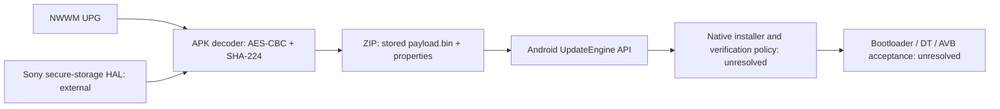

# M10 acquired Sony updater: format, installation and trust boundaries

2026-10-14. **One authorized read-only APK acquisition succeeded. No updater
functionality, service, extracted code or native library was executed.** H1 and
the denied proc/device-tree reads remained untouched. This is evidence toward
native Linux delivery, not an Android-player implementation or a successful boot.

## Acquisition and integrity

The exact target came from preserved complete U1 evidence, not a guessed path.
The one-shot reader rechecked eleven identities, package registration, ordinary
file metadata/size, then read the bounded content once, rechecked metadata/path
and repeated identities. Before/after transport guards and the existing held
tracker applied to all 27 observations. Host-only checks matched the trusted
server's process creation, listener owner, native image and pinned hash. No ADB
executable/lifecycle/reconnect was used. The latest physical-unit/stock-state
confirmation was reused with no known intervening change.

Result: **27/27 observations complete**, 138 connections, 1,365,777 combined
wire bytes. APK size **1,337,774 bytes**, SHA-256
`1d23a544bfa3f4cdbf9d8ef0514dbaaad985c6fa7ef70fdb52f786b4f2485b68`.
Raw frames, binary stdout and the preserved `automagic.apk` agree byte-for-byte.
Independent validation passed all hashes/counts, exact services/closed stdin,
host replies/binding, atomic selection, exit frames, file/path/identity rechecks,
limits and ZIP CRCs. All **825** earlier physical/authorization files are unchanged.
Exact paths, identifiers, APK, extracted members and disassembly remain ignored
and private under `build/m10/device-apk1-20261014-01/`,
`apk-acquisition-20261014-01/` and `updater-static-20261014-01/`.

`tools/acquire_updater.py` enforces a 16 MiB artifact maximum, rejects nonregular,
changed or oversized files, and promotes bytes only after full-session success.
It reuses the existing wire/guards with narrow operation-validation hooks. Only
the content operation gets a 30-second connection deadline; other connections
retain five seconds. The acquisition session has 300 seconds, 40 MiB combined
wire budget and 8,192-frame cap. U1/H1 limits were not enlarged. There is no
arbitrary target CLI, retry, root or content-transfer standing permission.

Ten new synthetic tests cover fixed scope, stale approvals/evidence, permission
and size gates, changed targets/metadata, partial binary interruption, invalid
ZIP/CRC/path input, exact output preservation and attempt reuse refusal. Full
tests: **Windows 132 total, 131 passed and one symlink-permission skip; WSL 132
passed**. Original replay/transport and standing-policy modules were not edited.
The adapter hook change alters new source-bound plan hashes; historical grants
and source snapshots were preserved, not silently repinned or reused.

## Verified package structure and declared components

**Verified from the acquired device-specific artifact:** 394 ZIP members,
1,439,153 total uncompressed bytes; one 741,404-byte DEX 039, 743 classes and
6,513 method IDs. DEX Adler-32 and SHA-1 structural checks match. There are 86
Sony updater classes including synthetic callbacks. No `lib/` native libraries
or `assets/` members were bundled. Resources are chiefly UI/XML plus
`resources.arsc`; no selected boot/DT/AVB image set was identified.

Manifest: `com.sony.walkman.systemupdater`, app version **3.0.2 / 30002**, minimum
and target SDK **34**. This app version is not the player's firmware version.
Components include `BootReceiver`, `ui.MainActivity`,
`services.PrepareStreamingService`, `services.AtmConfigDownloadService` and
`services.UpdateNotificationService`. Boot receiver/main activity are declared
exported; the notification job service declares `BIND_JOB_SERVICE`. AndroidX
initialization/profile components are also present. No component was invoked.
Declared permissions include reboot, cache access, network, foreground service,
boot completion, wakelock, media/storage management and notifications. Manifest
declarations and privileged placement do not establish actual runtime grants.

Bounded offline SDK parsers (aapt/aapt2/dexdump/apksigner, build-tools 36.0.0) all
exited zero. Their input/output and tool hashes are private. APK v3 verification
succeeded against its embedded RSA-2048 signer, whose subject names Sony Digital
Media Player. The signer certificate SHA-256 is
`608c60ddbb46c0bd6558a09fd1824f6d8a7d5bd3a9feca7f5f05e9eb527a67d5`.
This is embedded-signature integrity, not independent boot-key attestation.
Apksigner emitted a Java native-access warning for its own trusted SDK Conscrypt
library; no APK library or code was loaded. No proprietary bytes are published.

## Verified static update path

The following is **implementation evidence from DEX**, not an observed update.
Offsets are `classes.dex` code-item offsets; exact method/excerpt locators and
full private disassembly are in `method-locators.json` and the findings ledger.

| Function / code offset | Established implementation and limit |
| --- | --- |
| `AtmConfigDownloadUtil.mkAtomInfoUrl`, `0x064740` | Builds the distribution URL from trimmed `vendor.product_id` plus the first four characters of `vendor.service_id`. Those properties are absent from historical D1; they were not newly queried. Build flavor alone does not prove the selected 0002 distribution. |
| `AtmInfoConfig.chopInfo`, `0x0681a0` | Strips metadata text through a blank-line separator before XML parsing. The preserved 0002 manifest's separator ends at byte 67. This method is not a signature verifier; global metadata trust must not be inferred from stripping. |
| `UpdateDataDecipher$UpdateMetaStore.<init>`, `0x069604` | Copies four magic bytes and 56 ASCII hex characters beginning at offset 4, converting the latter into a 28-byte expected digest. The inspected constructor does not consume the decimal/reserved header fields. Their broader meaning remains unknown. |
| `UpdateProperties.<init>`, `0x069e94` | Obtains active key/IV arrays from `vendor.sony.securestorage@1.0::ISstorage/default` via `getKey` callback. Client defaults are 32/16 bytes; actual provisioned lengths/values, storage and caller policy were not observed. No service or key was requested. |
| `UpdateDataDecipher.decipher`, `0x069728` | Reads 128 bytes, checks NWWM and an all-zero-key failure condition, then decrypts from offset 128 with `AES/CBC/PKCS5Padding`. SHA-224 covers decrypted output and is compared with the header digest. Mismatch deletes output and throws; success can delete the downloaded source. This is an unkeyed digest check, not an asymmetric signature. |
| `PayloadSpecs.forNonStreaming`, `0x069264` | Opens the decoded ZIP, requires `payload.bin` with ZIP STORED compression, reads `payload_properties.txt`, and builds file URL, byte offset, size and properties. The firmware's actual decoded ZIP/members remain unavailable. |
| `UpdateManager.updateEngineApplyPayload`, `0x063db0` | Passes the payload URL/offset/size/properties to Android `UpdateEngine.applyPayload`. Callback/status code handles progress/completion. APK cache/download writes are distinct from the external native installation/partition-writing dependency. |
| `MainActivity.rebootSystem`, `0x066a10` | Requests `PowerManager.reboot` after the UI update workflow. It establishes no independent recovery entry. Not invoked. |

Unused-looking test key/IV constants exist in metadata-holder fields, but the
inspected active decoder reads `UpdateProperties` service results, not those
fields. They are not an established decoding key; no guessing/decryption was
attempted. The modern service dependency replaces the older caller-supplied-key
assumption in historical M2/A100 comparison work. Source availability is not
service accessibility, provisioning portability or accepted execution.

The APK also contains cache/debug-file branches and downloaded-file processing.
Their existence does not establish owner write access or relax native payload
authentication. No cache was read or written and no branch was exercised. Do
not treat a client test path as an accepted independent Linux delivery method.

## Authentication, recovery and remaining dependencies

**Identified boundaries:** Android APK signing; HAL-mediated decryption material;
plaintext SHA-224 integrity; external UpdateEngine handoff; subsequent OS/DT/AVB
and early boot acceptance. These are separate mechanisms. The inspected client
path contains no firmware public-key signature verification implementation;
generic signature references elsewhere in AndroidX are not OTA verification.
Actual native payload signature enforcement, trusted public keys, rollback and
partition policy are **unknown**. UpdateEngine error/status names recognize
verification failures but do not prove the selected service's enforcement.

Exact missing dependencies are the Sony secure-storage service implementation
behind the named HIDL interface/default instance, the build-matched framework/
native UpdateEngine implementation and its verification configuration, and a
decoded applicable stock OTA/boot/DT/AVB set. Generated HIDL client/proxy code is
in the DEX; it is not the HAL implementation. A selective filename enumeration
of 85,019 members of the existing shared GPL archive found no securestorage,
sstorage, automagic, update_engine or nwwm match; zero members were extracted.
This is a bounded negative result, not proof of global absence. Existing generic
AVB/kernel research remains relevant after selected bytes are acquired.

**Boot-route decision:** format understanding advanced from historical analogy
to an actual Sony consumer, but no custom payload acceptance was established.
The updater is a normal-Android preparation/installation client, not an
independently reachable loader. If the actual native installer accepts only
vendor-signed payloads, wrapping a changed Linux image in NWWM cannot authorize
it. Conversely, this APK alone cannot prove that every supported engineering/
owner-key route is absent. No verification bypass or installation is proposed.

**Preservation/recovery:** this APK acquisition preserves one code artifact, not
the player's original firmware, unique state or provisioning. The decoder can
alter cache/download files and installation delegates to a writer; running the
app would exceed read-only scope. Neither the UI's reboot path nor ordinary OTA
completion demonstrates same-board restoration after boot/AVB/slot damage.
Same-version reinstall, independently surviving recovery, complete restoration
bytes and rollback/unique-state treatment remain unresolved.

Highest-value next investigation: obtain build-matched native installer/public-
key-policy and HAL implementation artifacts, or a lawfully supplied decoded
official OTA, then trace signature coverage and selected boot/DT/AVB members.
Do not invoke `getKey`, retrieve provisioned secrets or assume embedded APK
signing/decryption grants custom-boot permission. Matching the update variant
would require the two identified ordinary properties under a separately approved
scope; neither is covered by this APK acquisition. Further device collection or
boot experiments require their own exact review. M10 remains open.
