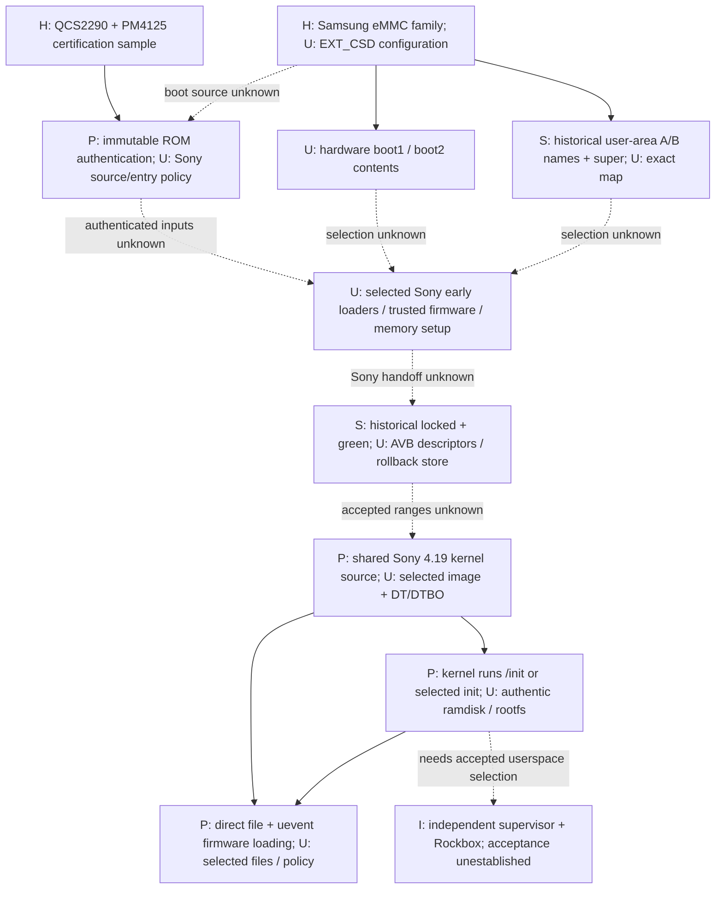

# M8 boot and storage architecture

2026-10-14. Host-only assessment. The certification sample uses
Samsung-marked eMMC, but the owner's storage configuration and the Sony early
loader chain remain unresolved. M8 establishes a register-level inspection
contract and traces published Sony kernel initialization; it establishes no
accepted independent boot or restoration operation.

## Evidence boundaries and component identity

**S** means applicable Sony documentation or preserved historical observation;
**H** means the FCC certification sample; **P** means component/platform source
or documentation; **I** means engineering inference; **U** means unresolved.
Shared Sony GPL source is authentic publication evidence, not proof of the
running configuration. These classifications apply throughout the M8 reports.

H: [M7 F1-F4](m7-fcc-evidence.md) identify SODAGREEN M/B REV. 1.03, QCS2290,
PM4125 and Samsung **KLMBG2JETD**. The storage suffix is not conclusively read.
The newly acquired Samsung-authored **KLMBG2JETD-B041** product brief, p. 1,
documents 32 GB, eMMC 5.1, two-bit MLC and an integrated storage controller.
Its package is 11.5 x 13 x 0.8 mm; specified operating range is -25 to 85 C.
This identifies a relevant variant, not the owner's exact suffix or usable
capacity. The PDF's URL names a different part; its rendered title and table
explicitly name KLMBG2JETD-B041. Copyright 1995-2017 is not a revision date.
[Samsung product brief, Avnet mirror](https://www.avnet.com/fsp/opasdata/d120001/medias/docus/190/SAM-KLM8G1GETF-B041-Datasheet.pdf).

The brief supplies no boot-region sizes, provisioning values or board wiring.
Detailed search results marked Samsung Confidential were not adopted as a
redistributable specification. JEDEC's site was inaccessible to the research
tool; no complete JESD84-B51 text was acquired. The detailed register contract
below is grounded in pinned Linux/Sony and mmc-utils source instead. Synthetic
4-MiB regions in the tests are **not measured Sony capacities**.

## Storage objects that must remain separate

| Object | Established meaning / source | Sony selection and restoration consequence |
| --- | --- | --- |
| eMMC user area | P: sector-addressed managed storage; `SEC_COUNT[215:212]` is little-endian in 512-byte units | H establishes the chip family; no owner EXT_CSD, user-area size or byte layout supplied |
| Hardware boot1 / boot2 | P: separate address spaces, each `BOOT_SIZE_MULT[226] * 128 KiB`; Linux calls these `mmcblkXboot0/1` | U: contents, boot enable and whether Sony ROM uses either. These are not Android slots |
| RPMB | P: separate replay-protected transaction area, advertised by byte 168 in 128-KiB units; authenticated writes use a key and counter | U: Sony uses, provisioning, ownership and recovery. Advertised region bytes are not a plain filesystem capacity; copying sectors cannot replay protected state |
| GP / enhanced areas | P: separately configured hardware areas; partition support/completion are distinct EXT_CSD fields | U: whether configured, boundaries or protection. Tool does not decode GP/enhanced extents |
| GPT entries | P: software partition map within a storage address space | S: historical D1 names, not preserved GPT sectors, CRCs, LBAs or a reconstruction manifest |
| Android A/B | P: boot/update slot selection and fallback policy above the storage hardware | S: historical `boot`, `recovery`, `dtbo`, `vbmeta` A/B names; U: active policy and surviving fallback. Two hardware boot regions do not implement A/B |
| Dynamic `super` | P: metadata maps logical partitions inside its backing partition | S: historical `super` name; U: actual metadata/extents and rootfs placement. Not another eMMC hardware region |
| Recovery | P: executable recovery userspace and its kernel/ramdisk dependencies | S: recovery partition names; U: independent entry, actual packaging, accepted reinstall and failure coverage |
| AVB metadata | P: descriptors connect verified images and rollback policy; not a partition allocator | S: locked/green historical state and vbmeta names; U: keys, descriptor graph, covered byte ranges and rollback storage |

Sources: Sony archive S, `kernel/msm-4.19/drivers/mmc/core/mmc.c:442-507,
544-549,598-622`; `include/linux/mmc/mmc.h:251-286,318-332`;
[Linux boot-region documentation](https://docs.kernel.org/driver-api/mmc/mmc-dev-parts.html);
[AOSP A/B](https://source.android.com/docs/core/ota/ab),
[dynamic partitions](https://source.android.com/docs/core/ota/dynamic_partitions/implement)
and [AVB](https://source.android.com/docs/security/features/verifiedboot/avb).
These platform documents describe boundaries; they supply no Sony partition values.

`PARTITION_CONFIG[179]` separates boot enable (bits 5:3), boot ACK (bit 6) and
current partition access (bits 2:0). Boot-enable codes 0/1/2/7 mean disabled,
boot1, boot2 or user area. Current access may select RPMB while boot2 remains
enabled. This register does not establish the SoC ROM's boot-source selection.
`BOOT_WP[173]`, `BOOT_WP_STATUS[174]`, `BOOT_CONFIG_PROT[178]` and
`USER_WP[171]` describe different protection controls/status. Reliable-write
registers 166/167/222 concern write semantics, not signature acceptance or a
recovery guarantee. A register capture alone cannot validate all protected
write groups, fuse state, RPMB key/counter state or calibration preservation.
Pinned [mmc-utils source](https://kernel.googlesource.com/pub/scm/utils/mmc/mmc-utils/+/c6692d5f9bf1ab6fbf5694a0b61477621cc4d016/mmc_cmds.c),
`do_read_extcsd`, `print_writeprotect_boot_status`, `do_rpmb_read_counter`,
`do_rpmb_write_block`; source inspected, utility never built or executed.

## Evidence-constrained boot model

Solid arrows below are dependencies, not a traced Sony execution log. Dotted
edges mark unselected storage or unknown Sony handoff. Names of Qualcomm loader
generations are deliberately absent from the Sony path.



Qualcomm's 2019 secure-boot overview, sections 1 and 3-5, supplies ROM-rooted
authentication and image identity/rollback constraints. Its example XBL,
XBL_SEC, QHEE and QTEE topology is **not established for this QCS2290 Sony**.
It does not specify Sony's eMMC boot region, fuse policy or service entry.
Separate authentication domains can govern early firmware, OS images and
peripheral firmware; changing userspace must satisfy its actual enclosing
chain. [Qualcomm overview](https://www.qualcomm.com/media/documents/files/secure-boot-and-image-authentication-technical-overview-v2-0.pdf).

| Stage / responsible component | Confirmed presence, inputs and trust boundary | Storage/memory dependency; failure; possible survivor; decisive missing proof |
| --- | --- | --- |
| Power/reset / PMIC and SoC | H: packages identified; U: rail/reset/boot-strap sequence | Board power policy and initial memory. Failure may prevent any interface; no documented Sony survivor. Need selected power/boot configuration |
| Initial ROM / SoC | P: immutable authentication root; U: Sony ROM behavior and selected source | Source area and hardware trust state unknown. ROM existence does not prove accessible service entry. Need applicable boot-source and authorized recovery documentation |
| Initial authenticated loading / unnamed Sony stages | I: loaders initialize the observed system; U: names, count, formats, authenticated ranges | eMMC region, DDR training/resources and accepted identity unknown. Failure precedes Linux; ROM service is hypothetical. Need genuine early-image manifest and compatible programmer policy |
| Trusted/power firmware / platform environments | P: SCM and RPM/PIL interfaces in shared source; U: exact images and order | Secure memory, shared memory, clocks and power resources. May stop OS/peripherals; no proven recovery bypass. Need selected firmware/dependency inventory |
| OS boot selection / Sony loader | S: historical A/B names and green/locked; U: loader implementation | Slot state, image chain, rollback and DT selection. Damaged shared metadata can affect both slots. Need actual loader policy, images and descriptors |
| Kernel/DT handoff / loader to Linux | P: ARM64 shared kernel; U: authentic selected DTB/DTBO/image/header | Reserved memory, command line, ramdisk and module ABI. Incorrect data can fail before recovery or unsafe peripheral initialization. Need matching selected bundle |
| Kernel driver initialization / Linux | P: SDHCI, SPMI/RPM, DSI, input and audio source | Driver-specific DT resources and firmware; absence may stall probes or prevent storage/display/safety. Higher service entry unverified. Need selected binding/resource graph |
| Peripheral image loading / kernel + secure firmware + userspace | P: `.mdt` and `.bNN` PIL requests plus authentication callback | Filesystem availability, firmware ABI, memory and trusted firmware. Failure can prevent audio or power services. No arbitrary replacement accepted. Need genuine firmware and loading owners |
| Initial userspace / kernel then init | P: `/init`, `rdinit`, `init` and root mounting code; S: historical Android ran | Accepted ramdisk/rootfs and mounts. Kernel panic or missing safety owners possible; stock recovery independent reachability U. Need original init/fstab and signed-range evidence |
| Independent Rockbox / proposed supervisor | Generic M6 implementation verified; Sony execution U | ALSA/KMS/evdev plus safety and authenticated dependencies. Generic shutdown does not prove PMIC shutdown. Need A/B/C gates in [execution assessment](m8-execution-paths.md) |

## Concrete host implementation

[`inspect_extcsd.py`](../tools/inspect_extcsd.py) reads an **existing regular
512-byte file only**; no ioctl, device acquisition, writes, keys or commands.
Only revision 8 is supported. It bounds input to 513 bytes, rejects wrong sizes,
unsupported revisions, reserved boot selectors, zero sector count and selected
zero-capacity boot/RPMB regions. It rejects symlinks/nonregular files and checks
opened identity/size/mtime. It reports selected register values, capacities,
separate boot/access fields and protection status. It is a partial decoder,
not a complete legality check, device authenticator or Sony layout detector.

The implementation is independently written from register facts in S and
pinned Linux v6.12/mmc-utils; no upstream executable code was imported. Future
legitimately supplied captures require provenance and separate privacy review;
M8 used **synthetic fixtures only**. No method for reading a device is provided.

```powershell
python -m unittest discover -s tests -p test_inspect_extcsd.py -v
python tools/inspect_extcsd.py <existing-synthetic-512-byte-file>
```

Eight deterministic tests pass on Windows and WSL: capacity/endian/max arithmetic,
all supported selection/access combinations, reserved/revision rejection,
capacity inconsistencies, protection/reliability separation, truncated/oversized
input, unchanged file and CLI failure. The [artifact report](m8-board-firmware-artifacts.md)
records the source hashes. No real EXT_CSD or eMMC boot contents were acquired.
